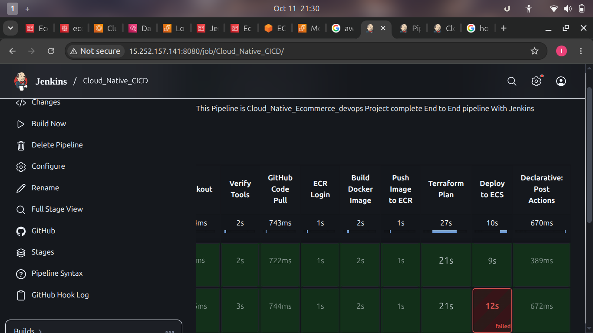
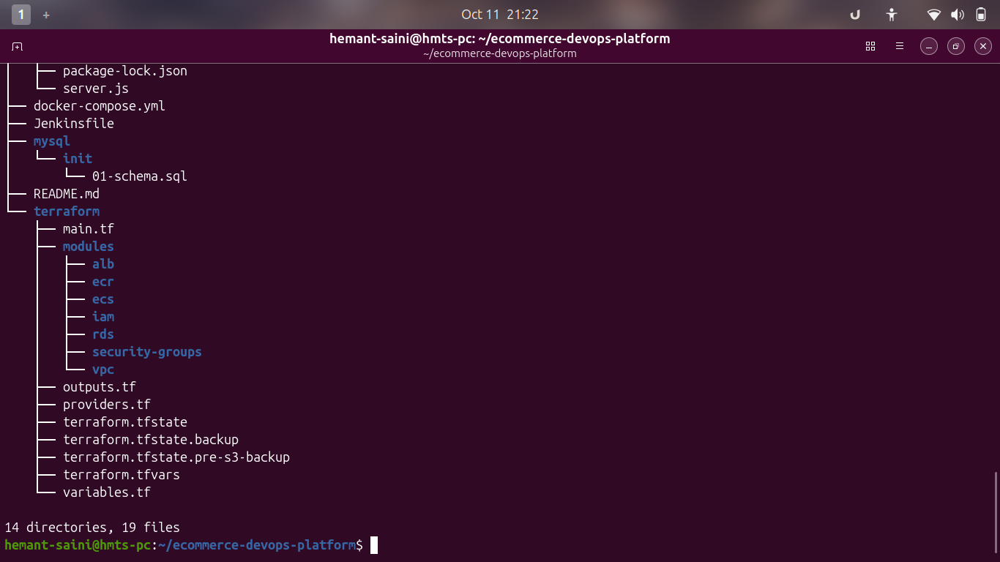
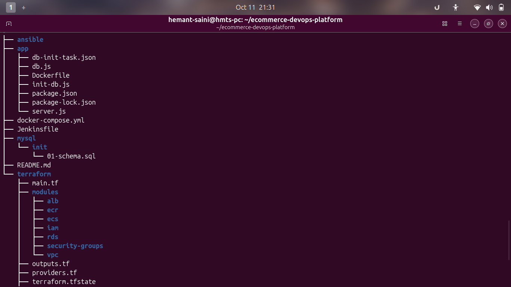
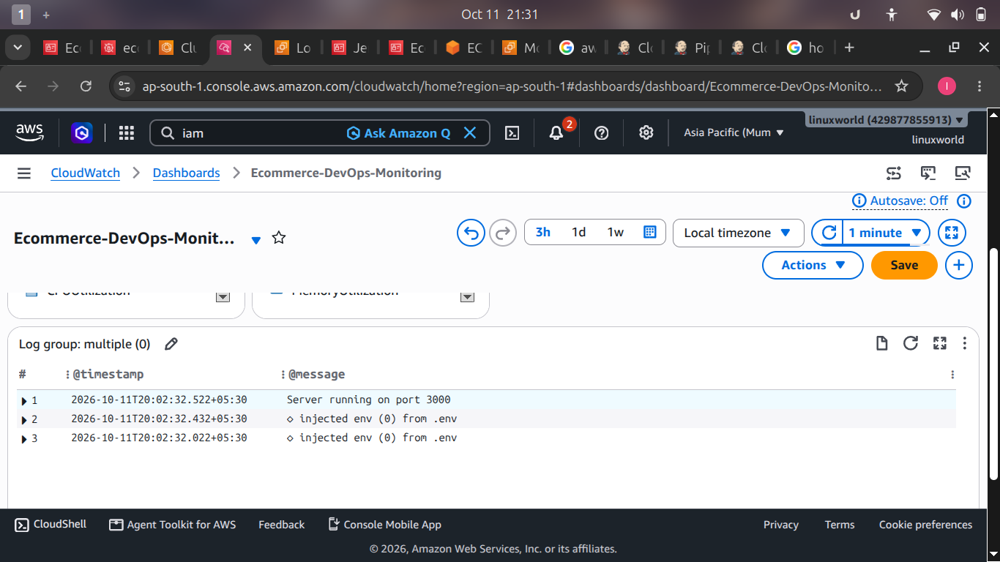
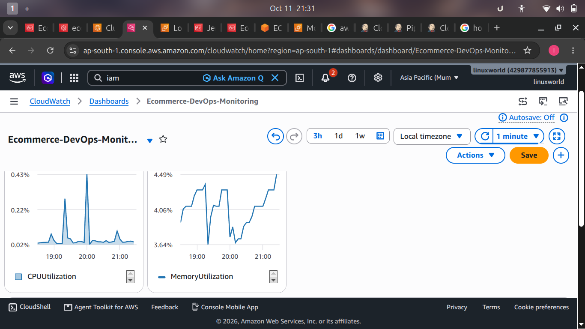

# Cloud-Native E-Commerce DevOps Project

An end-to-end DevOps project demonstrating containerization, CI/CD automation, Infrastructure as Code, AWS cloud deployment, and application monitoring.

## Architecture

GitHub → Jenkins CI/CD → Docker Build → Amazon ECR → Terraform → Amazon ECS Fargate → Application Load Balancer → Node.js API → Amazon RDS MySQL

CloudWatch is used for application logs, metrics, and monitoring.

## Tech Stack

- **Cloud:** AWS
- **Containerization:** Docker
- **Container Registry:** Amazon ECR
- **Container Orchestration:** Amazon ECS Fargate
- **CI/CD:** Jenkins
- **Infrastructure as Code:** Terraform
- **Networking:** Amazon VPC, Public and Private Subnets, Internet Gateway, NAT Gateway
- **Load Balancing:** Application Load Balancer
- **Database:** Amazon RDS MySQL
- **Secrets Management:** AWS Secrets Manager
- **Monitoring and Logging:** Amazon CloudWatch
- **Application:** Node.js, Express.js

## Key Features

- Automated CI/CD pipeline triggered by GitHub webhook events.
- Docker image build and push to Amazon ECR.
- AWS infrastructure provisioned and managed using Terraform modules.
- Containerized application deployment on Amazon ECS Fargate.
- Application Load Balancer routes incoming HTTP traffic to ECS tasks.
- Amazon RDS MySQL deployed in a private network.
- Database credentials retrieved through AWS Secrets Manager.
- CloudWatch log group for application logs.
- ECS service auto scaling configured with a target CPU utilization of 80% and a capacity range of 1–3 tasks.

## Infrastructure Components

Terraform modules are organized by responsibility:

- `vpc` — networking infrastructure
- `alb` — Application Load Balancer resources
- `ecs` — ECS cluster, task definition, service, logging, and scaling
- `ecr` — container image repository
- `iam` — IAM roles and permissions
- `rds` — relational database resources
- `security-groups` — network access rules

## CI/CD Workflow

1. Developer pushes code to GitHub.
2. GitHub webhook triggers the Jenkins pipeline.
3. Jenkins checks out the source code.
4. Docker image is built and tagged with the Jenkins build number.
5. Image is pushed to Amazon ECR.
6. Terraform plans and applies infrastructure changes and the updated ECS task definition.
7. ECS deploys the application using the new container image.


## ECS Fargate Auto Scaling

Configured AWS Application Auto Scaling for the ECS service using target tracking based on average CPU utilization.

**Configuration**
- Minimum tasks: 1
- Maximum tasks: 3
- CPU target: 20% for testing (temporary)
- Scale-out cooldown: 60 seconds
- Scale-in cooldown: 60 seconds

**Validation**
- Generate HTTP load against the application through the Application Load Balancer.
- Monitor ECS desired and running task counts.
- Observe CPU utilization and scaling activity using AWS CLI and CloudWatch.
- Verify that the service scales out when the target tracking policy conditions are met.

**Test Evidence**
- Add screenshots showing the ECS service before and after scaling.
- Add a CloudWatch CPU utilization graph.
- Add scaling activity output showing the scaling decision.

> Note: The 20% CPU target is a temporary testing configuration. Re-evaluate the target before using this setup for production workloads.


## Monitoring

- CloudWatch application logs
- ECS CPU and memory utilization metrics
- CloudWatch dashboard for operational visibility
- ECS service auto scaling configuration


## 📸 Project Screenshots

### 1. Jenkins CI/CD Pipeline


### 2. Project Infrastructure Overview


### 3. Terraform Project Structure


### 4. Amazon CloudWatch Application Logs


### 5. Amazon CloudWatch Monitoring Metrics


### 6. Amazon ECS Fargate Running Tasks


### 7. ECS Fargate Auto Scaling — 3 Tasks Running


## Repository Structure

```text
.
├── ansible/
├── app/
│   ├── Dockerfile
│   ├── db.js
│   ├── init-db.js
│   ├── package.json
│   └── server.js
├── mysql/
│   └── init/
├── terraform/
│   ├── modules/
│   │   ├── alb/
│   │   ├── ecr/
│   │   ├── ecs/
│   │   ├── iam/
│   │   ├── rds/
│   │   ├── security-groups/
│   │   └── vpc/
│   ├── main.tf
│   ├── providers.tf
│   ├── variables.tf
│   └── outputs.tf
├── docker-compose.yml
├── Jenkinsfile
└── README.md
```

## Security Considerations

- Database credentials are stored in AWS Secrets Manager.
- ECS tasks run in private subnets.
- Infrastructure is managed through Terraform.
- Sensitive credentials, Terraform state files, and local variable files must not be committed to Git.

## Project Status

Core AWS infrastructure, container deployment, Jenkins CI/CD, and CloudWatch logging and monitoring have been implemented. Further validation and improvements are ongoing.

## Author
~ Hemant Saini 
~ 7849969509

Developed as a hands-on cloud-native DevOps learning project using AWS, Jenkins, Docker, and Terraform.

